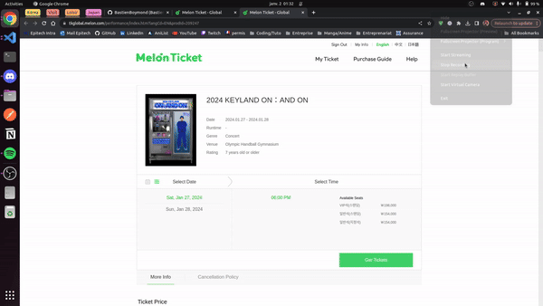

<div align="center">
    <h1>EasyConcertKorea</h1>
<br>
</div>

# 项目说明

- 本项目fork自：https://github.com/BastienBoymond/korea-concert-ticket-bot 在原项目基础上进行二改实现自己所需功能
- 目前功能设计只适合捡漏（只是一个辅助插件 做不到商业级的抢票能力）
- 项目完全免费 开源 可以自己拿去实现新功能
- 由于自己使用并不是很频繁，基本有用到去抢票时才会临时修正，所以在提Issues时请带上截图、详细问题描述及期望修复，我会在有空时修复（不过现在AI工具很发达 建议可以自己先找AI解决:D）
- 最后 祝大家都能顺利捡到原价票（骂过我老公名井南的除外）

## Quick Start

用一个 AI Agent 帮你完成部署和配置。推荐 [WorkBuddy](https://www.workbuddy.ai/) + DeepSeek V4.1 Flash，备选 [DeepSeek Harness](https://github.com/deepseek-ai/deepseek-harness)，用 Codex / Claude Code 也可以。打开 Agent 后，把下面这段话原样发给它：

```text
请帮我在本机部署并配置抢票插件 EasyConcertKorea：先把 https://github.com/brokenleg13/selfuse-ticket-bot 克隆到当前目录（已存在就 git pull），阅读仓库根目录的 AGENTS.md、docs/debug-guide.md 和 docs/platforms.md 后按文档完成部署——检查 Node.js 并运行 npm ci --prefix ticket-bot-plugin 和 npm test --prefix ticket-bot-plugin；问我要抢哪个平台（Interpark / YES24 / Melon）、演出链接、日期时间、区域、张数，按 docs/platforms.md 帮我整理好卡片每个字段该填什么；问我是否需要验证码识别，需要的话按 docs/captcha-service.md 第 5 节部署本地服务并用 /health 验证；你能自己完成的步骤直接做，必须由我操作的步骤（例如在 Chrome 加载插件、登录购票网站、在插件里填写飞书 Webhook / YES24 用户 ID 等敏感信息、保存卡片、点开始）整理成一份按顺序编号的清单给我，并告诉我每一步做完怎么确认成功；全程不要点击付款或提交订单。
```

Agent 会自己完成能做的步骤，再把需要你动手的步骤整理成清单给你。之后使用方法：

- 打开购票页，点卡片上的 `开始`；`接管` 暂停脚本，你自己手动操作；`继续` 恢复；`停止` 会让所有页面都停止。购票页右下角的状态小框会显示当前走到哪一步，也有这几个按钮；需要你动手时会响提示音（插件首页可以试听）。
- **出问题时**：把购票页地址、现象和状态小框里的文字发给 Agent，让它按 [调试指南](docs/debug-guide.md) 第 3 节连上浏览器自己调试，并交付修好的脚本。可直接复制的指令模板也在那一节。

> [!CAUTION]
> 使用自动化插件可能导致账号被平台封禁，后果自负。插件只辅助到付款页之前，付款请自己确认。
> Using this extension for automated booking may lead to a ban on the respective platforms. Use at your own discretion.

## 文档

| 文档 | 内容 |
|---|---|
| [AGENTS.md](AGENTS.md) | 给 AI Agent 的规则和代码地图（让 Agent 先读这个） |
| [docs/debug-guide.md](docs/debug-guide.md) | 本地部署、Agent 自助调试（CDP）、适配新购票流程 |
| [docs/platforms.md](docs/platforms.md) | 各平台卡片字段、运行流程、注意事项 |
| [docs/incidents.md](docs/incidents.md) | 卡点记录与迭代修复：运行记录、卡点规则、各平台卡点日志 |
| [docs/captcha-service.md](docs/captcha-service.md) | 验证码识别公共服务：API、部署、换其他 OCR、页面接入方法 |
| [docs/interpark-onestop-flow.md](docs/interpark-onestop-flow.md) | Interpark 新版流程的完整业务说明 |

## 迭代日志

### 2026-11 整改
- ThaiTicket 停止维护，代码移到 `archive/thaiticket/`；YES24 v1 归档到 `archive/yes24-v1/`。
- 配置统一到 `ticket-bot-plugin/config/config.js`：各平台默认参数、卡片表单字段、站点/接口地址都在这里，卡片填写的值优先。
- 新增通用运行框架 `scripts/common/runtime.js`，Melon / YES24 / Interpark 全部接入：
  - 卡片和状态小框提供 `接管` / `继续` / `停止`，停止和接管会同步到所有页面（包括 Melon 选座弹窗）。
  - 步骤卡住、页面出现 `try again` 等提示、脚本出错时推送飞书；卡片可以选择推送哪些事件。飞书改由插件后台发送。
- 状态小框做成组件 `scripts/common/status-panel.js`：显示每个页面声明的状态机步骤（✓ / ▶ / ○）、当前信息、最近的状态切换，需要人操作时高亮。
- 新增提示音组件 `scripts/common/sound.js`：需要人接管（手动验证码、暂停、自动停止）、卡住、异常、成功时响铃，由插件后台播放，不受购票页自动播放限制。插件首页可以试听。
- 验证码识别改为可扩展的公共服务：客户端 `scripts/common/captcha-client.js` 加上统一 API。可以换成其他 OCR 或 API 服务，页面接入由使用者的 Agent 自行完成。
- 不再需要油猴脚本：YES24 的预订按钮改由插件后台在页面环境里点击（`scripts/common/main-world.js`），弹窗屏蔽早已由插件内置。旧油猴脚本已删除。
- 浏览器弹窗（例如 Melon 的 try again）被自动关闭后会转给插件：命中卡点规则就按规则通知人/暂停/停止，没命中的也会推送并记录（issue #28）。
- 新增卡点记录机制：运行记录可在插件首页导出；卡点规则写在 `config.js` 的 `platforms.<平台>.rules`；每个平台的卡点日志在 `docs/incidents/`。Agent 按 [docs/incidents.md](docs/incidents.md) 自己补规则和修复。
- 新增 Agent 文档：`AGENTS.md`、新手调试指南、平台说明。

### 2026-10 Interpark 实页验证
- 演出 `26006903` / 场馆 `26000511`，`2026-10-07 19:45`，区域 `004`：后台接口返回 HTTP 200，共 1,000 个座位，轮询前后保持总览。验证时无余票。
- 批量查询：真实插件自动通过场次和本地 OCR 后，把 `001:004`、`001:005` 合并到同一个 `seatStatus` 请求，连续三次返回 HTTP 200。
- 有票实测：演出 `26010474` / 场馆 `26000166`，2026-10-17 18:00，自动锁定 1 张站立 A 区入场编号 354，进入 `step=price` 后自动停止。
- 票价自动化续测：同一张票自动选满 `1/1` 并进入付款页（共 146,000 韩元，未付款）。修正了步进器选满后 `aria-valuemax=0` 的计数判断。

### 2026-09 Interpark 新版 Onestop
- 支持 `tickets.interpark.com/onestop/schedule`、`/onestop/seat`、`/gates/*` 和 `/onestop` 入口，保留旧版 `BookMain.asp` 分支。
- 后台批量调用 `seatStatus` / `seatMeta`（每批最多 16 个区域），403 时只做一次前台检查，401 停止，429 按要求退避。
- 预选走页面自带处理函数并做 GraphQL 校验；进入票价页后按锁座数量自动选择票价，到付款页停止。
- 按钮和验证码使用组件结构选择器，不依赖翻译文案。

### Interpark NOL World
- 临时加更一集 InterPark，希望 Once 们都能捡到安可票 :D
- 切换到 NOL World 页面流程，后台刷票，右下角小框显示进度。
- 本地部署小模型后可以自动识别验证码；不会部署的话，可以让你的 Agent 读文档帮你装好。
- 卡片支持联系人、确认页自动填写，订购页超时自动重开。

### 2025-10-09
- 更新 Melon 前端刷票。
- 支持配置飞书 Webhook 通知。

### 2025-08-25
- 更新 ThaiTicket 抢票助手，增加自定义配置页面和手动启停（2026-11 起停止维护）。

### 2025-06-27
- YES24 改为直接调用接口爬取座位数据，效率更高。
- 需要填写 USERID（idCustomer）；现在在 YES24 卡片里填写。

### First Update
- YES24 刷票自用适配版，适配 Twice 抢票。
- 配合油猴脚本实现锁座一直到信用卡付款。
- 填写 Webhook 可以在刷票成功时发送飞书通知。

## Demo



## Credits

* <strong><a href="https://github.com/BastienBoymond">Bastien Boymond</a></strong>
